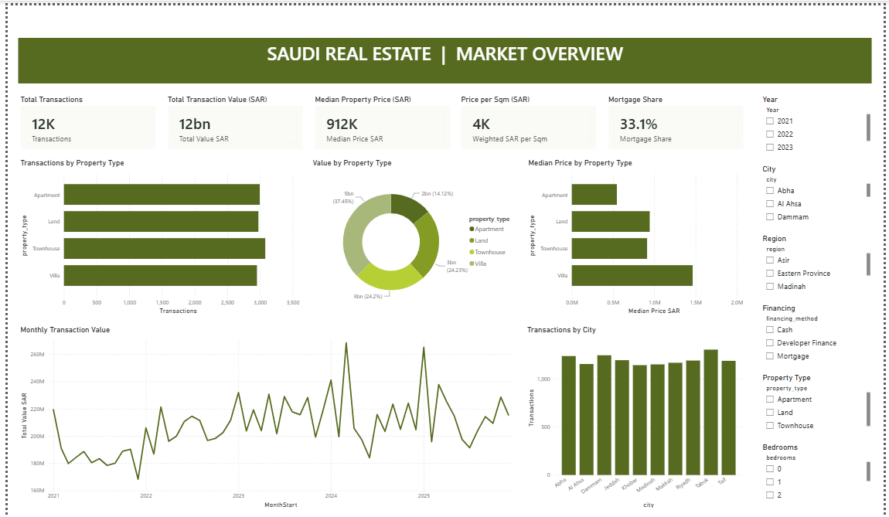
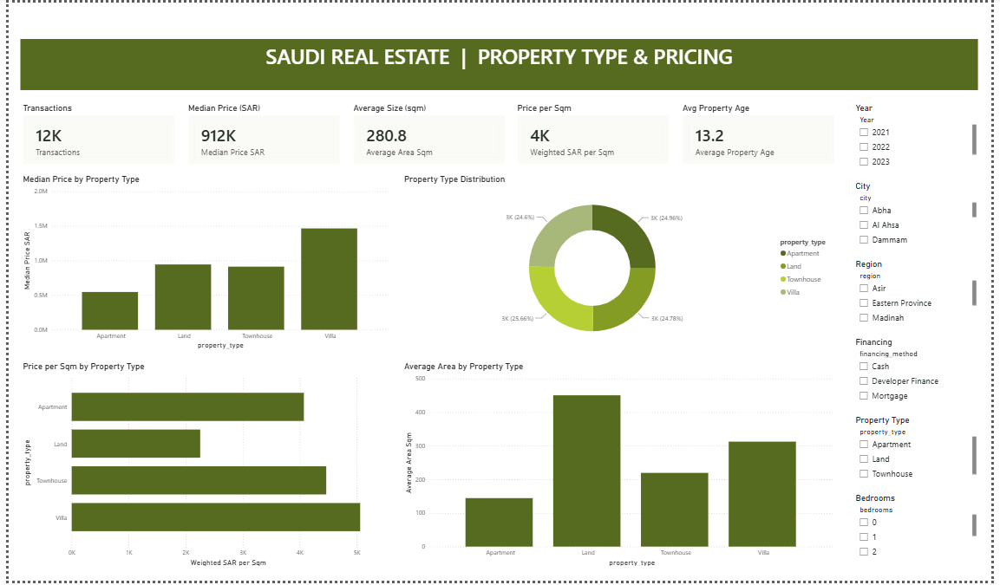
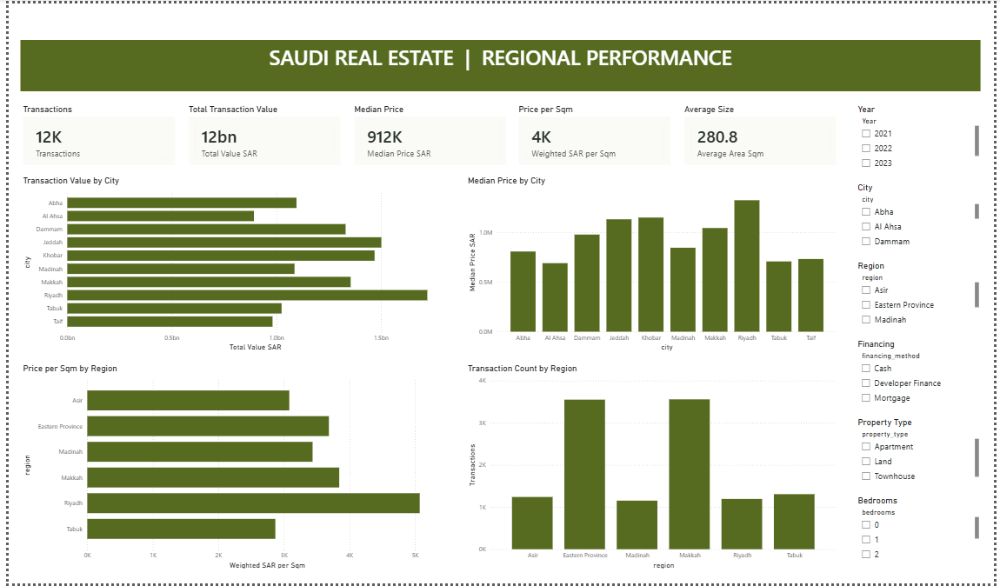
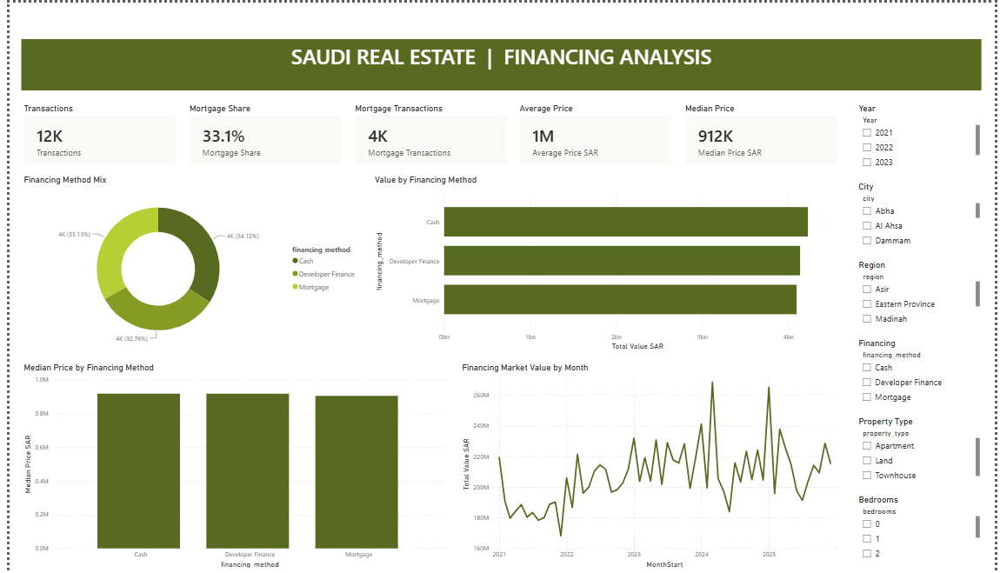
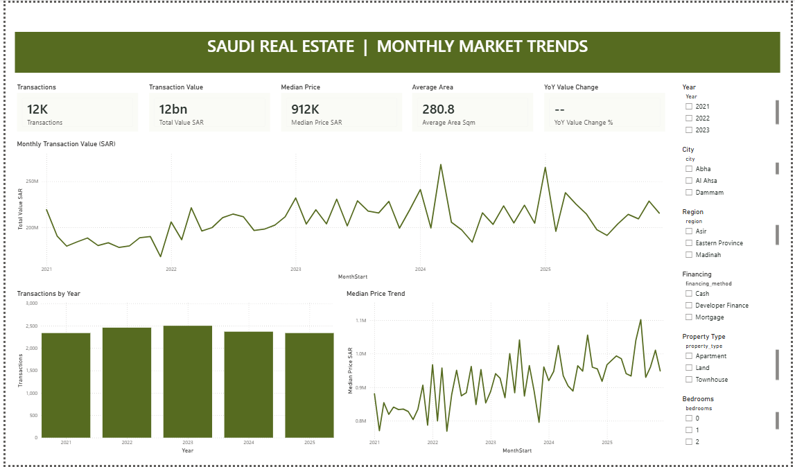

# Saudi Real Estate Market Analytics

**Power BI · SQL · Python · Data storytelling**

I wanted this project to go beyond a dashboard full of numbers. The idea was to explore how transaction data could help a real estate team ask better questions: Which cities deserve a closer look? Which property types account for the most value? Does a rise in transaction value mean more deals, or simply more expensive ones?

I used **12,000 synthetic property transactions across 10 Saudi cities**, covering 2021–2025. The dataset is simulated, so the findings below are an exercise in analytics and business decision-making—not a description of the actual Saudi property market.

## A look at the dashboard

The Power BI report has five pages: **Market Overview, Property Type & Pricing, Regional Performance, Financing Analysis, and Monthly Market Trends**.

## What stood out to me

| Finding in the simulated data | Why it matters |
|---|---|
| **Riyadh** accounts for about **SAR 1.72B** in transaction value, or **13.8%** of the total. | Transaction value and price per square metre can help narrow down cities for further research. |
| **Villas** make up **24.6%** of transactions but **37.4%** of total value. | A high-value segment isn't necessarily the highest-volume segment. |
| Financing is split between **cash (34.1%)**, **mortgage (33.1%)** and **developer finance (32.8%)**. | It's worth looking at financing options separately rather than treating every buyer the same. |
| Annual transaction value increased **16.4%** from 2021 to 2025, while transaction counts were **2,337 in both years**. | Looking at revenue or transaction value alone can hide what's happening to volume and deal size. |

Across the full dataset, simulated transaction value is **SAR 12.46B**, with a **SAR 912,309** median transaction price.

These findings are useful as examples of *how* to approach a business question. They don't prove real market demand, returns or revenue growth.

## How I'd use the analysis in a business setting

If I were presenting this to a brokerage or property research team, I'd start with three questions:

- **Where should we look more closely?** Compare city-level value, transaction count and property mix before deciding which markets need further research.
- **Which buyers might need different approaches?** Compare villas, apartments and other property types, then test whether financing preferences affect the customer journey.
- **What's really driving a change?** Review transaction volume, median price and total value together instead of assuming that a higher total means a busier market.

The next step in a real company would be to connect these patterns to actual leads, conversions, financing approvals and closed deals. This dataset doesn't contain those business outcomes, so I haven't attached invented revenue or cost-saving figures to the project.

For the numbers behind these observations, see my [business case and recommendations](docs/BUSINESS_CASE_AND_INSIGHTS.md).

## Tools and approach

- **Power BI:** Five-page report, interactive visuals, DAX measures and an editable project.
- **SQL:** Queries for transaction summaries, regional comparisons, financing mix and year-over-year trends.
- **Python (pandas):** Data checks and grouped analysis outputs.
- **SQLite and CSV:** Queryable data and reproducible summary tables.

The saved quality report records **12,000 unique transaction IDs, no missing values and no duplicate rows**.

## Explore the files

| Folder / file | What's inside |
|---|---|
| [Power BI report (.pbix)](powerbi/Saudi_Real_Estate_Analytics.pbix) | Dashboard to open in Power BI Desktop |
| [Editable Power BI project (.pbip)](powerbi/Saudi_Real_Estate_Analytics.pbip) | Project entry point; keep it with its Report and SemanticModel folders |
| [data/](data/) | Synthetic source transactions |
| [analysis/](analysis/) | Summary CSVs, SQLite database and data-quality results |
| [python/](python/) | pandas analysis script |
| [sql/](sql/) | SQL analysis |
| [docs/](docs/) | Business insights and project checks |
| [assets/screenshots/](assets/screenshots/) | Dashboard screenshots |

## Run the analysis

1. Install Python and pandas: `pip install pandas`
2. From the repository root, run `python python/analyze_real_estate.py`.
3. Review the generated summaries in `analysis/`.
4. Open the `.pbix` file in Power BI Desktop. The `.pbip` version is also included for anyone who wants to explore the report definition and model.

The SQL file expects a table called `transactions`; a SQLite database is included under `analysis/`.

## A note on the data

This is a **portfolio case study using synthetic data**, not official Saudi real estate statistics. It shows the analysis process and the kinds of decisions a dashboard could support. Before using an approach like this in practice, I'd validate it against real transaction records and business KPIs.

The Power BI files and screenshots are included for review. Anyone using the editable project should check the data refresh and visual interactions in their own Power BI Desktop environment.

---

**Ahmed Fazil** · [GitHub profile](https://github.com/AhmedFazil007)
